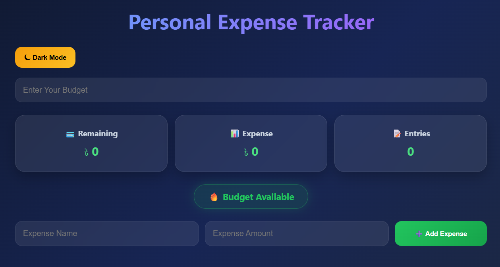

# Personal-Expense-Tracker

1. Abstract:

This project presents a Personal Expense Tracker Desktop Application developed using ElectronJS, HTML, CSS, and JavaScript. It helps users manage daily expenses, set budgets, and monitor spending activities. The application provides a simple and user-friendly interface for personal financial management. The project demonstrates the practical use of ElectronJS in desktop application development.

2. Introduction:

The Personal Expense Tracker is an offline desktop application designed to help users record and monitor expenses easily. It allows users to manage budgets and track spending without requiring an internet connection. The application was developed using ElectronJS and modern web technologies. The main goal is to simplify personal financial management through a desktop platform.

3. Methodology:

The project was developed using a structured and modular approach.

Desktop Framework: ElectronJS

Frontend: HTML, CSS, JavaScript

User Interface: Responsive Dashboard Design

Main Features:

Budget Management
Expense Tracking
Expense Deletion
Remaining Balance Calculation
Dark Mode Functionality

The application takes user input, processes expense data, updates the dashboard dynamically, and displays budget status based on spending activity.

5.Conclusion:

The project successfully achieved its objective of developing a simple and efficient expense management system. Users can track expenses, manage budgets, and monitor spending through an easy-to-use interface. The application works offline and demonstrates the effectiveness of ElectronJS for desktop application development. Future improvements may include database integration and graphical expense analysis.
